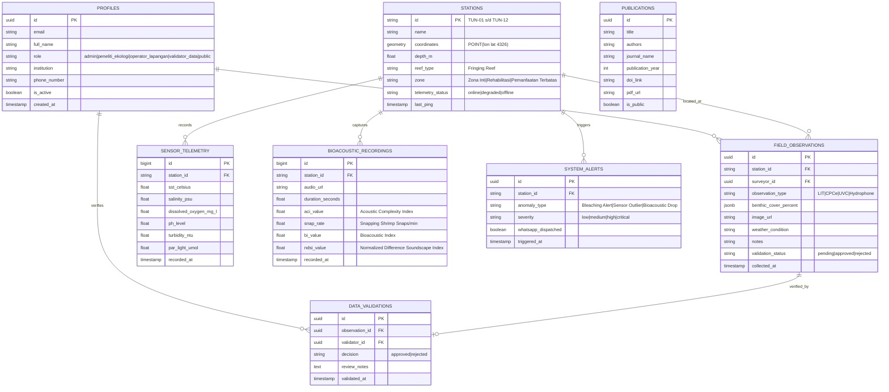

# REEFSIGHT — MASTER ARCHITECTURE & USER GUIDEBOOK
**Pengembangan Platform Kecerdasan Ekologis untuk Analisis Dinamika dan Tekanan Lingkungan Terumbu Karang di Pulau Tunda, Kabupaten Serang, Banten**

---

## 1. RINGKASAN EKSEKUTIF (EXECUTIVE SUMMARY)

### 1.1 Latar Belakang & Urgensi Ilmiah
Ekosistem terumbu karang di Pulau Tunda, Teluk Banten (5.813° S, 106.274° E) menghadapi tekanan ganda yang masif:
1. **Tekanan Antropogenik Lokal**: Jalur pelayaran kapal tongkang/kargo Selat Sunda, sedimentasi aliran muara sungai Banten, serta praktik penangkapan ikan yang tidak ramah lingkungan (*destructive fishing*).
2. **Tekanan Perubahan Iklim Global**: Peningkatan suhu permukaan laut (*Sea Surface Temperature* / SST) yang memicu fenomena pemutihan karang (*coral bleaching*) dan penurunan kapasitas kalsifikasi.

**REEFSIGHT** hadir sebagai platform kecerdasan ekologis (*Ecological Intelligence Platform*) terintegrasi yang menjembatani kesenjangan antara data observasi lapangan konvensional (*in-situ dive transect*) dengan teknologi mutakhir: **IoT Telemetry Buoy (EchoVision)**, **Bioakustik Bawah Air (Underwater Soundscape)**, **Penginderaan Jauh Satelit Sentinel-2 (WebGIS)**, dan **Pemodelan Spasial Cellular Automata**.

---

## 2. ARSITEKTUR TEKNOLOGI SISTEM (SYSTEM TECHNOLOGY STACK)

```
┌─────────────────────────────────────────────────────────────────────────┐
│                           CLIENT / USER LAYER                           │
│  Desktop & Mobile Browsers (Safari, Chrome, Firefox, Edge, iOS/Android) │
└────────────────────────────────────┬────────────────────────────────────┘
                                     │
┌────────────────────────────────────▼────────────────────────────────────┐
│                    NEXT.JS 15 APP ROUTER (REACT 19)                     │
│  ┌───────────────────────┬──────────────────────┬────────────────────┐  │
│  │   Public Workspace    │  Research Workspace  │  Admin Workspace   │  │
│  │   (13 Modul Publik)   │  (Field & Lab QA/QC) │  (Fleet & Security)│  │
│  └───────────────────────┴──────────────────────┴────────────────────┘  │
│  ┌───────────────────────────────────────────────────────────────────┐  │
│  │                   INTERACTIVE VISUAL ENGINES                      │  │
│  │  • MapLibre GL (WebGIS, 12 Buoy Telemetry, Sentinel-2 Layers)     │  │
│  │  • Three.js (EchoVision 3D Interactive Exploded Hardware Model)   │  │
│  │  • Web Audio API (Real-Time Bioacoustic FFT Waveform/Spectrogram) │  │
│  │  • Canvas / SVG (Cellular Automata Projection & ArcGIS Swipe)     │  │
│  └───────────────────────────────────────────────────────────────────┘  │
└────────────────────────────────────┬────────────────────────────────────┘
                                     │ REST API / Force-Dynamic Handlers
┌────────────────────────────────────▼────────────────────────────────────┐
│                       BACKEND & CLOUD PLATFORM                          │
│  ┌───────────────────────────────────────────────────────────────────┐  │
│  │            Vercel Serverless Edge Runtime (Next.js 15.5)          │  │
│  │  • /api/stations               • /api/field-observations         │  │
│  │  • /api/validations (QA/QC)    • /api/auth/register               │  │
│  │  • /api/publications           • /api/alerts/dispatch-whatsapp    │  │
│  └───────────────────────────────────────────────────────────────────┘  │
│  ┌───────────────────────────────────────────────────────────────────┐  │
│  │                      SUPABASE CLOUD POSTGRESQL                    │  │
│  │  • PostgreSQL 16 Engine with PostGIS Geospatial Extension         │  │
│  │  • Supabase Auth (RBAC Metadata, JWT Sessions)                    │  │
│  │  • Row Level Security (RLS) & Separation-of-Duties Triggers       │  │
│  │  • Supabase Storage (Underwater Transect Photos & Audio Waveforms)│  │
│  └───────────────────────────────────────────────────────────────────┘  │
└─────────────────────────────────────────────────────────────────────────┘
```

### 2.1 Rincian Komponen Utama
- **Frontend Framework**: Next.js 15.5.29 (App Router) dengan React 19, TypeScript 5, dan Tailwind CSS.
- **State Management & UI Styling**: Responsive mobile-first drawer navigation, Lucide React icons, Tailwind Merge, CLSX.
- **Geospatial & WebGIS**: MapLibre GL JS v6.17 dengan integrasi GeoJSON 12 stasiun mooring Pulau Tunda, raster bathymetry, dan slider komparasi tutupan karang.
- **3D Hardware Visualization**: Three.js (WebGL Canvas) dengan orbit controls, interaksi exploded-view 5 komponen EchoVision, dan lighting dinamis.
- **Database & Auth**: Supabase Cloud PostgreSQL 16 + PostGIS (`https://lxyimkikmhecajusxyez.supabase.co`) dengan hak akses RBAC granular.

---

## 3. STRUKTUR DATABASE & SKEMA RELASIONAL (DATABASE SCHEMA & ERD)

Skema database tersusun dalam 8 entitas ternormalisasi dengan dukungan indeks spasial (`GIST` pada koordinat PostGIS):



### 3.1 Penegakan Aturan Integritas (Separation of Duties)
Untuk menjamin integritas saintifik data terumbu karang, sistem database memberlakukan aturan mutlak melalui PostgreSQL Trigger:
> **Aturan**: Petugas Lapangan (*Operator Lapangan*) yang mengunggah data survei **TIDAK DAPAT** memvalidasi datanya sendiri. Verifikasi QA/QC wajib dilakukan oleh akun berbeda dengan peran *Validator Data*.

---

## 4. MATRIKS HAK AKSES PERAN PENGGUNA (RBAC MATRIX)

| Fitur / Modul | Public Visitor | Operator Lapangan | Peneliti Ekologi | Validator Data | Administrator |
| :--- | :---: | :---: | :---: | :---: | :---: |
| **Katalog Ensiklopedia Terumbu Karang** | ✅ Baca | ✅ Baca | ✅ Baca | ✅ Baca | ✅ Kelola |
| **Peta WebGIS 12 Stasiun Mooring** | ✅ Baca (Publik) | ✅ Baca (Detail) | ✅ Baca (Detail) | ✅ Baca (Detail) | ✅ Kelola Stasiun |
| **Analisis Citra Sentinel-2 (Map Swipe)** | ✅ Interaktif | ✅ Interaktif | ✅ Interaktif | ✅ Interaktif | ✅ Kelola Layer |
| **Proyeksi Cellular Automata (2030-2040)**| ✅ Simulasi | ✅ Simulasi | ✅ Kalibrasi Model | ✅ Simulasi | ✅ Kelola Dataset |
| **Eksplorasi Biodiversitas & Hubungan** | ✅ Baca | ✅ Baca | ✅ Ekspor Data | ✅ Baca | ✅ Kelola Spesies |
| **Audio Bioakustik & FFT Spektrogram** | ✅ Dengar | ✅ Dengar | ✅ Analisis Indeks | ✅ Dengar | ✅ Kelola File |
| **Model 3D EchoVision (Exploded View)** | ✅ Interaktif | ✅ Interaktif | ✅ Interaktif | ✅ Interaktif | ✅ Konfigurasi IoT |
| **Formulir Pengumpulan Data Lapangan** | ❌ Akses Ditolak| ✅ Buat & Unggah | ❌ Akses Ditolak | ❌ Akses Ditolak | ✅ Pantau |
| **Pemeriksaan & Verifikasi QA/QC** | ❌ Akses Ditolak| ❌ Akses Ditolak | ❌ Akses Ditolak | ✅ Setujui/Tolak | ✅ Audit Log |
| **Pemberitahuan Anomali WhatsApp** | ❌ Akses Ditolak| ❌ Akses Ditolak | ❌ Akses Ditolak | ❌ Akses Ditolak | ✅ Kirim Disposisi |
| **Manajemen Akun & Role RBAC** | ❌ Akses Ditolak| ❌ Akses Ditolak | ❌ Akses Ditolak | ❌ Akses Ditolak | ✅ CRUD Akun |

---

## 5. PANDUAN PENGOPERASIAN MODUL (MODULE OPERATIONAL GUIDE)

### 5.1 Public Workspace (13 Modul Interaktif)

1. **Home (Ecological Encyclopedia)**:
   - Banner hero interaktif dengan visual bawah laut Pulau Tunda.
   - Kartu taksonomi 7 bentuk pertumbuhan karang (*Acropora Branching, Massive, Encrusting, Submassive, Foliose, Mushroom, Soft Coral*).
   - Metrik ringkas profil pulau: Luas perairan ± 2,8 km², panjang garis pantai ± 7,2 km, tipe karang tepi (*fringing reef*).
2. **WebGIS & Deployment**:
   - Peta interaktif berbasis MapLibre GL menampilkan 12 titik buoy mooring (`TUN-01` s/d `TUN-12`).
   - Marker berkode warna status (*Hijau: Sehat/Normal, Kuning: Waspada, Merah: Anomali Suhu/Bleaching*).
   - Panel telemetry popup real-time: Suhu SST (°C), Salinitas (PSU), pH, Oksigen Terlarut (mg/L), Kekeruhan (NTU).
3. **Coral Distribution (Sentinel-2 ArcGIS Interpretation)**:
   - Slider transparansi layer tutupan karang hasil analisis klasifikasi berbasis objek (*OBIA*).
   - Mode *Map Swipe* (sebelum vs sesudah) untuk melihat perubahan tutupan dari waktu ke waktu.
   - Donut chart distribusi persentase tutupan masing-masing bentuk karang.
4. **Coral Projection (Cellular Automata Modeling)**:
   - Simulasi proyeksi spasial tutupan karang untuk tahun 2030, 2035, dan 2040.
   - 3 Skenario prediktif:
     - *Baseline*: Tekanan lingkungan berjalan seperti tren historis saat ini.
     - *High Climate Pressure*: Peningkatan SST +1.5°C dengan frekuensi Marine Heatwaves tinggi.
     - *Active Restoration*: Efek penerapan Kawasan Konservasi Perairan dan penanaman fragmen karang buatan.
5. **Biodiversity Explorer**:
   - Direktori visual spesies karang dan ikan karang (*Reef Fish*) Pulau Tunda.
   - Pengelompokan trofik: Herbivora (*Scarus*, *Acanthurus*), Karnivora (*Lutjanus*, *Epinephelus*), Omnivora (*Chaetodon*).
   - Matriks keterkaitan simbiotik antara kesehatan mikrohabitat karang dan biomassa ikan karang.
6. **Reef Health Index (RHI) Assessment**:
   - Indikator kesehatan terumbu karang komposit terintegrasi (skor baseline: **76.4 / 100**).
   - Radar chart 5 dimensi: Tutupan Karang Hidup (LCC), Densitas Ikan Herbivora, Kualitas Air, Keragaman Bioakustik, dan Rasio Alga/Makroalga.
7. **Ocean Environment**:
   - Grafik deret waktu anomali Suhu Permukaan Laut (SST) terhadap batas MMM (*Maximum Monthly Mean*).
   - Indikator *Degree Heating Weeks* (DHW) untuk mendeteksi risiko pemutihan karang dini.
8. **Acoustic Intelligence**:
   - Pemutar audio bioakustik rekaman hidrofon bawah laut Pulau Tunda.
   - Visualisasi spektrogram frekuensi real-time (FFT) membedakan suara *snapping shrimp* (frekuensi 2–10 kHz) dan vokalisasi ikan teritorial (frekuensi rendah 100–1000 Hz).
9. **Prototype Intelligence (EchoVision 3D Hardware)**:
   - Model 3D interaktif pelampung IoT pemantau terumbu karang.
   - Tombol *Exploded View*: Membongkar komponen alat secara terpisah (Kubah Panel Surya, Kompartemen Baterai & LoRa/4G, Pelampung Polyethylene, Sonde Multi-Parameter, dan Rantai Pemberat/Jangkar Mooring).
10. **Eco-Tourism & Conservation**:
    - Perencanaan zonasi kesesuaian wisata bahari (*Diving*, *Snorkeling*, dan *Zona Inti Perlindungan*).
    - Perhitungan daya dukung lingkungan (*Carrying Capacity*) per hari untuk mencegah degradasi terumbu akibat wisatawan.
11. **Research & Publications**:
    - Repositori dokumen saintifik, laporan teknis, dan jurnal ilmiah terindeks seputar ekologi laut Teluk Banten.
12. **ERD & System Architecture**:
    - Dokumentasi interaktif struktur database PostGIS, alur data sensor IoT, dan diagram relasi tabel.
13. **About REEFSIGHT**:
    - Profil inisiatif riset kolaboratif antara akademisi, peneliti BRIN, dan komunitas pelestari karang lokal Pulau Tunda.

---

### 5.2 Research Workspace (Workflow Operasional Lapangan & QA/QC)

#### A. Alur Kerja Operator Lapangan (Field Data Collection)
1. Buka workspace melalui tombol **Research** di header atas, lalu pilih peran **Operator Lapangan**.
2. Masuk ke tab **Field Data Collection**.
3. Ikuti panduan 5 langkah wizard:
   - *Langkah 1*: Pilih stasiun penempatan buoy (`TUN-01` s/d `TUN-12`).
   - *Langkah 2*: Masukkan tanggal, jam penyelaman, dan kondisi cuaca perairan.
   - *Langkah 3*: Input parameter kualitas air manual/sonde (SST, Salinitas, pH, DO, Turbiditas).
   - *Langkah 4*: Unggah foto transek bawah air (*Underwater Photo Transect*).
   - *Langkah 5*: Tulis catatan anomali lapangan (misal: ditemukannya sampah jaring atau bleaching lokal) lalu klik **Kirim Data ke Antrean Validasi**.

#### B. Alur Kerja Validator Data (QA/QC Verification)
1. Buka workspace dengan peran **Validator Data**.
2. Masuk ke tab **Data Validation (QA/QC)**.
3. Sistem akan memuat daftar observasi berstatus `Pending Review`.
4. Buka detail observasi untuk memverifikasi kesesuaian nilai parameter dengan batas wajar ekologis Pulau Tunda.
5. Pilih salah satu tindakan:
   - **Setujui (Approve)**: Data diverifikasi, diberi stempel validasi QA/QC, dan langsung disinkronkan ke layer publik dan database PostGIS.
   - **Tolak (Reject)**: Berikan catatan alasan penolakan (misal: data suhu outlier di luar batas instrumen) untuk ditinjau ulang oleh operator terkait.

---

### 5.3 Admin Workspace (Fleet Management & Security)

1. **Dashboard Ringkasan Platform**: Memantau statistik total observasi yang masuk, stasiun aktif, kapasitas penyimpanan Supabase, dan sesi login aktif.
2. **User Management**: Mengelola akun pengguna platform, menyetujui pendaftaran baru dari peneliti luar, dan mengalokasikan hak akses RBAC.
3. **Prototype Fleet Management**: Memonitor status kesehatan baterai, sisa daya sel surya, dan latensi transmisi seluler/LoRa dari masing-masing buoy EchoVision di laut.
4. **Alert Center & WhatsApp Dispatch**:
   - Sistem mendeteksi otomatis jika terjadi anomali (misal: SST melebihi ambang batas pemutihan atau indeks ACI drop mendadak).
   - Admin dapat meninjau anomali dan menekan tombol **Dispatch via WhatsApp API** untuk mengirim notifikasi peringatan otomatis ke nomor telepon koordinator patroli lapangan di Pulau Tunda.

---

## 6. PANDUAN DEPLOYMENT & KONFIGURASI ENVIRONMENT

### 6.1 Variabel Lingkungan (Environment Variables)
Simpan variabel berikut di dashboard penyedia hosting (misal: **Vercel Settings → Environment Variables**):

```env
# Koneksi Database & Auth Supabase Cloud
NEXT_PUBLIC_SUPABASE_URL=https://lxyimkikmhecajusxyez.supabase.co
NEXT_PUBLIC_SUPABASE_PUBLISHABLE_KEY=your_supabase_publishable_key
SUPABASE_URL=https://lxyimkikmhecajusxyez.supabase.co
SUPABASE_SECRET_KEY=your_supabase_secret_key
SUPABASE_JWKS_URL=https://lxyimkikmhecajusxyez.supabase.co/auth/v1/.well-known/jwks.json

# Konfigurasi Notifikasi WhatsApp Gateway (Opsional untuk Produksi)
WHATSAPP_GATEWAY_URL=https://api.fonnte.com/send
WHATSAPP_API_TOKEN=your_whatsapp_token_here
```

### 6.2 Perintah Build & Run Lokal
```bash
# Instalasi dependensi
npm install

# Menjalankan server pengembangan lokal (Port 3000)
npm run dev

# Kompilasi build produksi Next.js
npm run build

# Menjalankan server produksi
npm run start
```

---

## 7. KESIMPULAN & TAHAP PENGEMBANGAN BERIKUTNYA
Platform **REEFSIGHT** telah teruji stabil, aman, responsif di seluruh perangkat, dan memiliki identitas visual yang otentik. Pengembangan berkelanjutan dapat mencakup integrasi model *Machine Learning Computer Vision* otomatis berbasis YOLOv11 untuk deteksi spesies ikan secara instan dari unggahan video transek lapangan.
